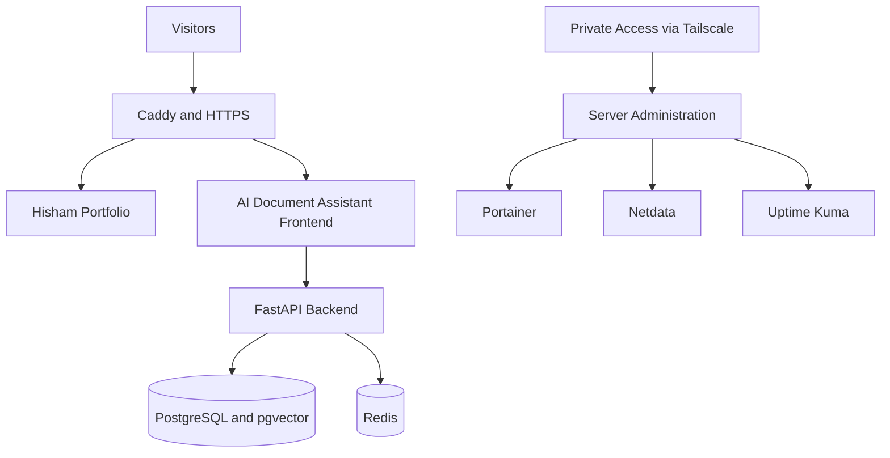
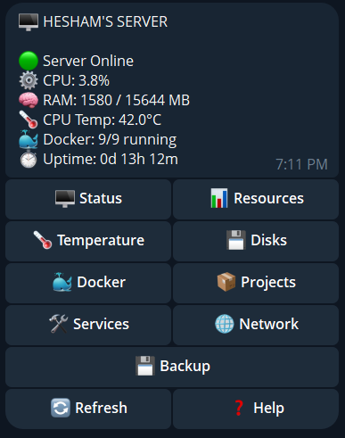
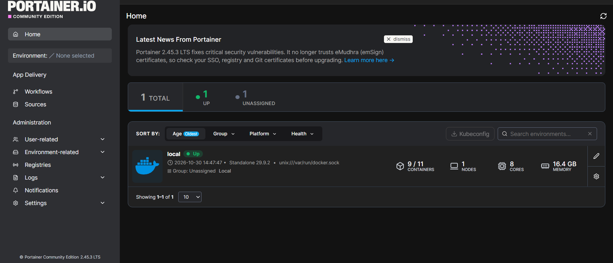
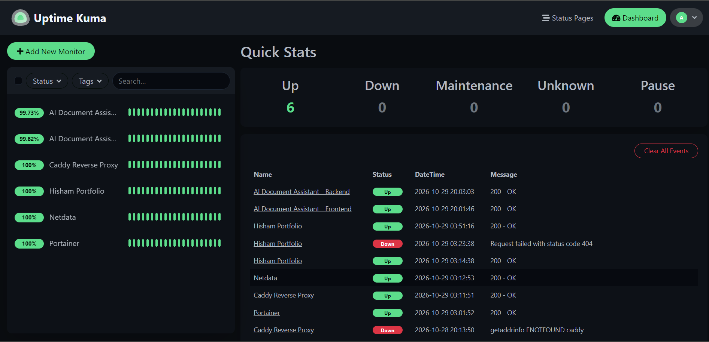
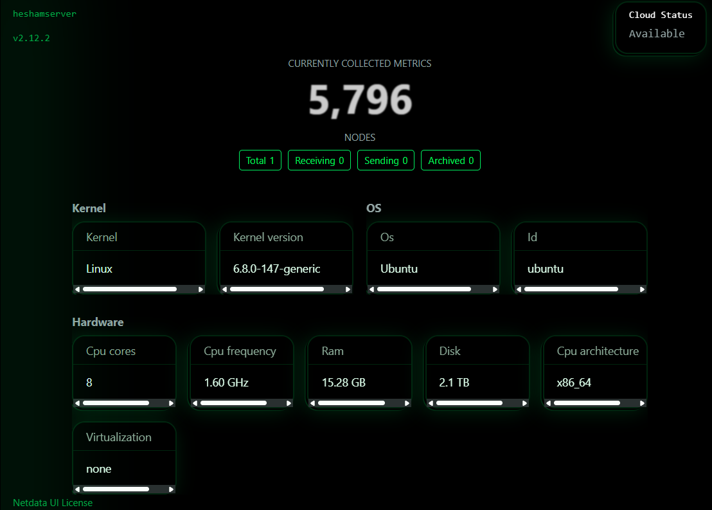

# Production Home Server

I built this server because free tier servers sleep more than cats! 🐈

I wanted a place to run my projects without worrying about sleeping instances, deployment limits, or relying on someone else's infrastructure.

What started as a spare Lenovo ThinkPad is now the machine hosting my projects, with automated deployments, monitoring, backups, and remote management.

## What Runs on It

| Component | Purpose |
| --- | --- |
| Ubuntu Server 24.04 LTS | Operating system |
| Docker and Docker Compose | Application containers and orchestration |
| Caddy | Reverse proxy with automatic HTTPS |
| PostgreSQL and Redis | Database and supporting services for AI Document Assistant |
| Portainer | Docker container management |
| Uptime Kuma | Availability monitoring and alerts |
| Netdata | Server performance and resource monitoring |
| Tailscale and SSH | Secure remote access |
| Telegram Bot | Server monitoring and alerts from my phone |

The server runs on a Lenovo ThinkPad X390 with 16 GB of RAM, an internal NVMe drive for the operating system, and a separate 2 TB external SSD for application data.

It primarily uses wired Ethernet, with WiFi configured as a fallback.

## Hosted Applications

### Hisham Portfolio

**Website:** [hishamjouda.com](https://hishamjouda.com)

My personal portfolio website, hosted directly on my home server.

### AI Document Assistant

**Website:** [ai.hishamjouda.com](https://ai.hishamjouda.com)

A full stack application built with Next.js and FastAPI. It uses PostgreSQL, pgvector, and Redis to support document processing, semantic search, and AI powered conversations.

Both applications run in separate Docker containers, with Caddy handling incoming HTTPS traffic.

I keep their deployment and runtime configuration separate so changes to one application do not interrupt the others.

## System Architecture

## Automated Deployment

One of the parts I spent the most time on was building the deployment system for AI Document Assistant.

When I merge code into the `main` branch, the server checks GitHub for a new commit and verifies that its GitHub Actions checks have passed.

Once the checks are successful, the deployment system:

1. Validates the new commit and deployment state.
2. Updates the application code.
3. Builds the new Docker images.
4. Replaces only the relevant application containers.
5. Checks container health before considering the deployment successful.
6. Records the deployment result.

The database, Redis, and portfolio remain running throughout the deployment.

For supported application updates, the system can restore the previous Docker images if the new release fails its health checks.

Changes involving database migrations or deployment infrastructure require manual approval.

I designed the deployment process so the server checks GitHub for approved updates. There is no need to expose a deployment webhook or give GitHub direct SSH access to the machine.

Deployment activity is logged, and I can inspect the system without triggering a release.

## Monitoring and Alerts

I wanted to be able to check my server from anywhere, especially when I am away from home.

To make that possible, I built a private Telegram bot that provides information about:

1. Server status and uptime
2. CPU usage and memory consumption
3. CPU temperature
4. Disk usage and storage status
5. Docker containers and hosted projects
6. System services
7. Network information
8. Backup status

I also use three monitoring tools.

### Uptime Kuma

Monitors application availability and services, and sends alerts when something goes down.

### Netdata

Provides detailed information about CPU usage, memory, disk activity, and overall server performance.

### Portainer

Allows me to inspect and manage Docker containers through a web dashboard.

Administrative dashboards and SSH access are available through my private Tailscale network.

## Backups and Recovery

The server automatically creates backups every day at **3:00 AM**.

I also maintain a separate backup copy on an external drive and have tested restoring backup data.

I implemented a storage check that verifies the external SSD is mounted before dependent services start.

This prevents applications from accidentally writing data into an empty mount directory when the external drive is disconnected.

I also tested:

1. Automatic service startup after reboot
2. Docker container recovery
3. Network fallback between Ethernet and WiFi
4. Telegram alerts
5. Application availability after restart
6. Backup restoration

Ubuntu security updates are automated as well.

The goal is simple: if the machine restarts while I am away, my applications should return without requiring manual intervention.

## Screenshots

### Telegram Monitoring Bot

A private Telegram bot that allows me to monitor the server and check its status directly from my phone.

### Portainer

An overview of the Docker environment and running containers.

### Uptime Kuma

Availability monitoring for the hosted applications and supporting services.

### Netdata

Detailed server metrics and system resource monitoring.

## What This Project Taught Me

Running applications on my own hardware has been a different experience from simply pushing code to a hosting platform.

I have had to think about disk mounts, service dependencies, boot order, network recovery, deployment safety, backups, and what happens when something goes wrong.

Building this server taught me that deploying an application is only the beginning.

Keeping it running, monitoring it, recovering from failures, and making updates safely are just as important.

I am continuing to improve the setup as I add projects and learn more about operating production services.

This repository documents the architecture and the engineering decisions behind it.

Sensitive credentials, private network details, and production data are not included.
